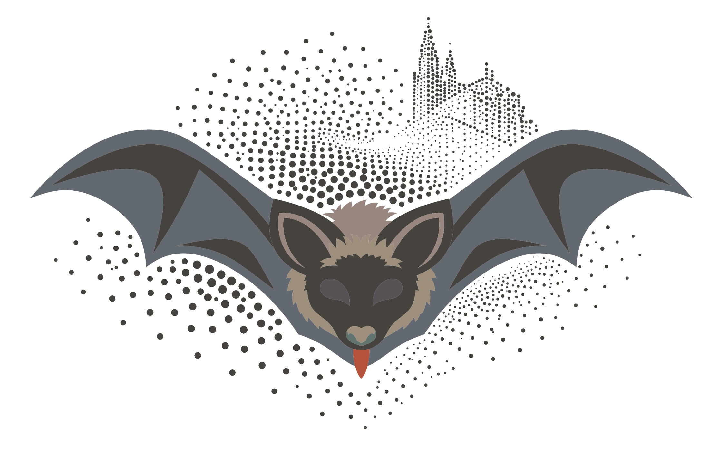

<p align="center"></p>

# Megabat

Point cloud tools for scan-to-BIM in Grasshopper (Rhino 8).

Megabat makes large point clouds workable in Grasshopper and leads from the raw scan to building elements: thin, crop, detect planes, snap rooms, walls and openings from rough sketches, and cut architectural sections.

## Installation

1. Download the ZIP from [Releases](https://github.com/barisWenzel/megabat/releases).
2. Copy its content (`Megabat.gha`, `Megabat.Core.dll`, `0Harmony.dll`, `Megabat.Rhino.rhp`) into a folder `%AppData%\Grasshopper\Libraries\Megabat`.
3. On Windows, right click the files › Properties › tick *Unblock* if shown.
4. Restart Rhino. The **Megabat** tab appears in Grasshopper.
5. Optional, for the Rhino commands: drag `Megabat.Rhino.rhp` from that folder into the Rhino window once.

## Workflow

```
Scan (registered)
  └─ Cloud ─ Downsample ─ CropBrep / SplitSlices
                             └─ Segmentize ─ Classify
                                               ├─ SnapPolygon   rooms and wall runs
                                               ├─ SnapOpening   windows and doors
                                               └─ Section       plans and sections
     FitColumn for round columns, Show for display
```

The geometric elements are semi-automatic on purpose: you sketch roughly, Megabat snaps to the points, and every result reports its deviations in `Info`. Where there are no points (occlusion), the sketch stays as drawn.

## Components

| Group | Component | Purpose |
|---|---|---|
| 1 Cloud | [Cloud](docs/components/Cloud.md) (parameter) | Reference a point cloud from Rhino, no copy, thinned preview |
| | [ImportCloud](docs/components/ImportCloud.md) | Read e57, ply, xyz and other files directly into Grasshopper |
| | [Downsample](docs/components/Downsample.md) | Thin to a target count (every k-th point or voxel grid) |
| | [CropBrep](docs/components/CropBrep.md) | Points inside closed Breps, one cloud per Brep |
| | [SplitSlices](docs/components/SplitSlices.md) | Split at parallel planes (e.g. storeys) |
| | [MergeClouds](docs/components/MergeClouds.md) | Merge several clouds into one |
| | [ExportCloud](docs/components/ExportCloud.md) | Write clouds to PLY or XYZ files instead of baking |
| | [ViewPoints](docs/components/ViewPoints.md) | Standpoints that see most of the surfaces (cameras for Detect, scanner positions) |
| | [MeshToCloud](docs/components/MeshToCloud.md) | Mesh vertices as a cloud, so the cloud tools work on meshes |
| | [CloudToMesh](docs/components/CloudToMesh.md) | Faces of the original mesh whose vertices are still in a cloud |
| | [MeshCrop](docs/components/MeshCrop.md) | Cut a large mesh at a Brep or planes, much faster than Mesh Split |
| | [ReduceMesh](docs/components/ReduceMesh.md) | Fast mesh reduction by vertex clustering |
| | [MeshClosest](docs/components/MeshClosest.md) | Closest points on a mesh for many points or a cloud, in parallel |
| 2 Segments | [Segmentize](docs/components/Segmentize.md) | Find planes (RANSAC), output as segments |
| | [Classify](docs/components/Classify.md) | Horizontal / vertical / inclined, snap to Z and main direction |
| | [Deconstruct Segment](docs/components/DeconstructSegment.md) | Plane, points, type of a segment |
| 3 Elements | [SnapPolygon](docs/components/SnapPolygon.md) | Snap a sketched room or wall run to the walls |
| | [SnapOpening](docs/components/SnapOpening.md) | Snap a sketched window or door to the opening, reveal depth |
| | [FitColumn](docs/components/FitColumn.md) | Round column by circle fit |
| | [SegmentRect](docs/components/SegmentRect.md) | One rectangular surface per segment, edges trimmed to the neighbours, optional outline |
| | [Openings](docs/components/Openings.md) (experimental) | Windows and doors from the holes in the walls |
| | [Detect](docs/components/Detect.md) (experimental) | Objects named in a text prompt (Grounding DINO, needs Python) |
| 4 Section | [Section](docs/components/Section.md) | Architectural section with view beyond |
| 5 Display | [Show](docs/components/Show.md) | Preview with line weight, point size and colour |
| 6 Photo | [ImportColmap](docs/components/ImportColmap.md) | Oriented photos from a COLMAP model, laid out as image board |
| | [Deconstruct Photo](docs/components/DeconstructPhoto.md) | Camera plane, image rectangle, file and intrinsics of a photo |
| | [Measure](docs/components/Measure.md) | Click image points with epipolar lines, stored as Rhino points |
| | [Intersect](docs/components/Intersect.md) | 3D points from the image clicks (forward intersection) |
| | [Georef](docs/components/Georef.md) | Scale and position: Helmert from control points or 3 points and a distance |
| | [Ortho](docs/components/Ortho.md) | Orthophoto of a planar face, e.g. a facade |

Every component shows its name below the icon, describes all inputs and outputs in the tooltip and reports counts, deviations and run time in `Info`.

## Examples

The folder [`examples`](examples) holds one Grasshopper file per workflow (cloud tools, segments, snapping, sections, photogrammetry, object detection) together with a small test cloud from the 3DSES dataset. See [examples/README.md](examples/README.md).

## Experimental scripts

The folder [`scripts`](scripts) holds C# script components that are being tested before they become part of the plugin, and the Python setup for [Detect](docs/components/Detect.md). See [scripts/README.md](scripts/README.md).

## Why Megabat: the preview bottleneck

With a scan of several million points, plain Grasshopper quickly becomes unusable: the canvas freezes and the viewport stutters. There are two reasons.

1. **Copying.** The Grasshopper Point Cloud parameter copies the whole cloud when it references it from Rhino and again whenever the data is passed to the next parameter. Every copy costs time and memory.
2. **Drawing.** Every parameter and component that holds a cloud draws all of its points in the preview, on every redraw. Three parameters in a row with 10 million points each means 30 million points per frame.

Megabat solves both:

1. **No copies.** The Megabat `Cloud` type is passed on by reference. Megabat components never modify their input, they always create new clouds for their outputs, so sharing is safe.
2. **Thinned preview.** Clouds are drawn from a cached, thinned copy (every k-th point, colours kept). Computation always uses all points.
3. **PreviewGuard.** The same thinning is applied to normal Grasshopper point clouds (via a Harmony patch on `GH_PointCloud`), so clouds from other plugins are covered too.

Measured in Rhino 8 (random cloud with colours, chain of three parameters, time to solve):

| Points | Grasshopper Point Cloud | Megabat Cloud |
|---:|---:|---:|
| 1 000 000 | 26 ms | 7 ms |
| 5 000 000 | 61 ms | 6 ms |
| 10 000 000 | 118 ms | 9 ms |

Referencing a 10 million point cloud from Rhino: 93 ms with the Grasshopper parameter (copy), below 1 ms with Megabat. The copying cost grows with every parameter in the chain, while Megabat stays constant.

### PreviewGuard

A button in the Grasshopper canvas toolbar, next to the preview modes.

1. **Click:** switch on or off. It is on at every start of Rhino; switching off only lasts for the current session.
2. **Arrow:** choose the maximum number of points per cloud (250 k, 500 k, 1 M, 2 M) or type your own value. The default is 1 000 000. The chosen value is remembered.
3. The first time a cloud is thinned in a session, a short message explains what happens.
4. **Level of detail (octree)**, in the arrow menu: Megabat clouds are drawn from an octree instead of a fixed thinned copy. Only the visible parts are drawn, finer the closer they are, so zooming in shows the full detail while the point limit holds per cloud and view. The octree is built once per cloud in the background (a few seconds for ten million points); until then the thinned cloud is shown. Off by default; the choice is remembered. Per cloud it can be set on the Cloud parameter (right click › Display).

## Rhino: large clouds as light proxies

Even with Megabat, a scan with tens of millions of points slows Rhino itself down: the viewport, selection, saving and undo all handle every point. The Rhino commands keep only a thinned **proxy** in the document; the full cloud stays in a file.

| Command | What it does |
|---|---|
| `MegabatImport` | Reads a file (`.e57`, `.ply`, `.3dm`, `.xyz`, `.pts`, `.txt`, `.csv`) and adds a proxy with a chosen number of points (default 500 000). The file stays where it is. Meshes (`.obj`, `.stl`, `.fbx`, `.off`, `.ply` with faces) get a reduced mesh as proxy (default 200 000 faces). |
| `MegabatProxy` | Turns selected point clouds into proxies. The full cloud is written as binary PLY (double precision) into a folder `<file>_clouds` next to the .3dm. Selected meshes are written there as .3dm. |
| `MegabatFull` | Brings the full cloud or mesh back into the document, e.g. to snap to every point or to export. |

E57 files are read with the E57 importer built into Rhino 8 (all scans merged, scan poses applied, scaled from metres into the document units). PLY and text files carry no units and are taken as they are.

A proxy is a normal point cloud object: select it, move it to a layer, reference it in Grasshopper. When the **Cloud** parameter references a proxy, Megabat computes with the full cloud from the file and shows `full cloud from …` in the tooltip. Files are cached, so they are read only once while they do not change. The path is stored absolute and relative to the .3dm, so a project folder can be moved.

Snapping in Rhino only finds the proxy points. Transforming a proxy in Rhino does not transform the file.

## Building

Requires the .NET SDK 8 or newer (Windows).

```
dotnet build Megabat.sln -c Release
```

The output is in `src/Megabat/bin/Release/net8.0-windows/`. `Megabat.Core` contains all algorithms and the file reader without any Grasshopper dependency; `Megabat` contains the Grasshopper components, types and the PreviewGuard; `Megabat.Rhino` contains the Rhino commands (`src/Megabat.Rhino/bin/Release/net8.0-windows/Megabat.Rhino.rhp`).

## License

MIT, see [LICENSE](LICENSE).
